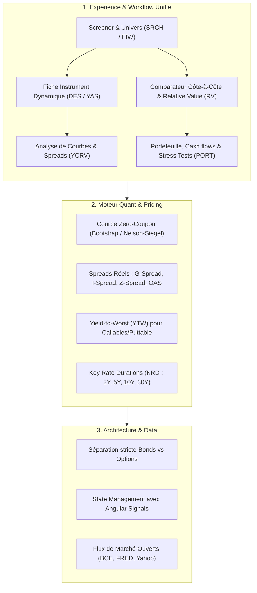

Guide complet des obligations : comprendre, comparer et investir
Les obligations sont une composante essentielle des marchés financiers. Elles permettent de percevoir des revenus, de diversifier un portefeuille et de prendre des risques différents de ceux des actions. Mais attention : une obligation n’est pas nécessairement un placement sans risque, même lorsqu’elle offre un rendement élevé ou qu’elle est émise par un État.
Pour bien les analyser, il faut maîtriser cinq éléments : le rendement, le risque de crédit, la sensibilité aux taux, la liquidité et les caractéristiques de l’émetteur. Ensuite viennent les critères ESG, la fiscalité et la place de l’obligation dans un portefeuille.
1. Qu’est-ce qu’une obligation ?
Une obligation est un titre de dette. Lorsque tu achètes une obligation, tu prêtes de l’argent à un État, une entreprise ou une autre entité.
Exemple simple
Montant investi
1 000 €
Coupon annuel
4 % = 40 €
Durée
5 ans
Remboursement prévu
1 000 €
Hypothèse : obligation achetée au pair, coupons annuels fixes, émetteur solvable et conservation jusqu’à l’échéance.
Dans cet exemple, tu perçois 40 € par an pendant cinq ans, puis récupères normalement les 1 000 € à l’échéance.
Mais trois notions doivent être distinguées :
•	Le nominal : le montant que l’émetteur doit rembourser à l’échéance, généralement.
•	Le coupon : les intérêts contractuels versés périodiquement.
•	Le prix de marché : le prix auquel l’obligation s’échange aujourd’hui.
Le prix de marché peut être de 900 €, 1 000 € ou 1 100 €, même si le nominal reste de 1 000 €.
C’est précisément ce qui rend l’analyse obligataire intéressante : le coupon ne suffit pas à mesurer la performance.
Les principales catégories d’obligations
1. Obligations souveraines
Émises par les États : OAT françaises, Bunds allemands, Treasuries américains, BTP italiens.
Elles présentent des risques de crédit, de taux et parfois de change. Le risque dépend fortement du pays et de la devise.
2. Obligations d’entreprises
Émises pour financer des investissements, refinancer des dettes ou financer l’activité.
Elles offrent souvent un rendement supérieur aux obligations souveraines comparables, en contrepartie d’un risque de crédit potentiellement plus élevé.
3. High yield et investment grade
Les obligations investment grade ont une notation de crédit relativement élevée. Les obligations high yield sont moins bien notées et offrent généralement une prime de rendement supérieure.
Le high yield peut se comporter comme un actif risqué proche des actions pendant les crises.
4. Obligations vertes, sociales et durables
Les fonds levés financent des projets ou dépenses répondant à des objectifs environnementaux ou sociaux, selon le cadre de l’émission.
Le label ne garantit ni le remboursement, ni un rendement supérieur, ni une meilleure qualité de crédit.
D’autres familles méritent d’être connues :
•	Obligations à taux fixe, variable ou indexées sur l’inflation.
•	Obligations convertibles en actions.
•	Obligations subordonnées, notamment bancaires.
•	Obligations sécurisées par des actifs (covered bonds).
•	Obligations perpétuelles, sans échéance contractuelle classique.
•	Obligations zéro coupon, qui ne versent pas d’intérêt périodique.
•	Obligations structurées, dont le remboursement dépend de formules ou d’actifs sous-jacents.
2. Comment comparer deux obligations ?
Il faut comparer des obligations sur une base homogène : même devise, échéance proche, même structure de remboursement et risques comparables.
Voici la grille d’analyse à utiliser.
Critère	Ce qu’il indique	Question à se poser
Rendement actuariel (YTM)	Rendement annualisé théorique jusqu’à l’échéance	Quel rendement si les flux prévus sont payés et si je conserve le titre ?
Coupon	Intérêt contractuel	Quel revenu périodique vais-je recevoir ?
Prix	Cours de l’obligation	Est-elle achetée avec une décote ou une prime ?
Duration	Sensibilité temporelle des flux aux taux	Quelle est sa sensibilité aux taux ?
Convexité	Courbure de la relation prix-taux	La sensibilité change-t-elle fortement si les taux bougent ?
Notation de crédit	Évaluation externe du risque de défaut	Quelle est la qualité de crédit estimée ?
Spread de crédit	Surcroît de rendement par rapport à une référence	Quelle rémunération le marché exige-t-il pour ce risque ?
Liquidité	Facilité à revendre	Pourrai-je vendre rapidement sans forte décote ?
Devise	Exposition au change	Le rendement peut-il être effacé par une variation de change ?
Fiscalité	Rendement après impôts et prélèvements	Que vais-je réellement conserver ?
ESG	Caractéristiques environnementales, sociales et de gouvernance	Quels risques extra-financiers et quels objectifs sont pris en compte ?
Règle fondamentale : ne compare jamais uniquement les coupons. Une obligation qui verse 7 % peut être moins intéressante qu’une obligation qui verse 4 % si son prix est élevé, son risque de défaut important ou sa liquidité faible.
3. Les rendements : les indicateurs à maîtriser
Il existe plusieurs façons de mesurer le rendement d’une obligation. Chacune répond à une question différente.
A. Le coupon
Le coupon correspond aux intérêts contractuels versés par l’émetteur.
\text{Taux de coupon}=\frac{\text{Coupon annuel}}{\text{Nominal}}
Exemple : une obligation de 1 000 € avec un coupon annuel de 50 € a un taux de coupon de 5 %.
Le coupon peut être fixe, variable ou indexé sur un indice. Il ne change pas nécessairement lorsque le prix de l’obligation évolue.
B. Le rendement courant (current yield)
Il rapporte le coupon annuel au prix actuel de l’obligation.
\text{Rendement courant}=\frac{\text{Coupon annuel}}{\text{Prix de marché}}
Exemple : coupon de 50 €, prix de marché de 900 €.
\frac{50}{900}=5{,}56\%
Le rendement courant est donc de 5,56 %. Mais il ne tient pas compte du remboursement final, de la décote ou de la prime à l’achat, ni de la réinvestition des coupons.
C. Le rendement actuariel à l’échéance (Yield to Maturity, YTM)
C’est l’un des indicateurs les plus importants pour comparer des obligations classiques.
Le YTM est le taux qui égalise le prix payé aujourd’hui avec la valeur actualisée des flux futurs attendus.
P=\sum_{t=1}^{n}\frac{C_t}{(1+y)^t}
+\frac{N}{(1+y)^n}
Avec :
•	: prix de l’obligation ;
•	: coupon reçu à la période ;
•	: nominal remboursé à l’échéance ;
•	: nombre de périodes ;
•	: rendement actuariel par période, avec une convention de calcul cohérente.
Le YTM prend en compte les coupons et le gain ou la perte entre le prix d’achat et le remboursement final.
Exemple : deux obligations comparées
Caractéristique	Obligation A	Obligation B
Nominal	1 000 €	1 000 €
Coupon annuel	5 %	3 %
Prix d’achat	1 000 €	950 €
Échéance	5 ans	5 ans
YTM approximatif	5 %	4,16 %
L’obligation B verse moins de coupons, mais sa décote à l’achat améliore son rendement actuariel. Dans cet exemple simplifié, A conserve néanmoins le rendement actuariel le plus élevé.
Attention : le YTM est un rendement théorique, pas une promesse de performance. Il suppose notamment que les paiements prévus sont honorés et repose sur des conventions de calcul. Le rendement effectivement réalisé dépend aussi du réinvestissement des coupons, des frais, de la fiscalité et, si tu revends avant l’échéance, du prix de revente.
D. Les autres mesures de rendement
Indicateur	Utilité
Yield to Call (YTC)	Rendement si l’émetteur exerce une option de remboursement anticipé à une date prévue
Yield to Worst (YTW)	Plus faible rendement calculé parmi les scénarios contractuels pertinents, notamment les dates de remboursement anticipé
Rendement réel	Rendement après prise en compte de l’inflation
Rendement net	Rendement après les frais et, selon la définition retenue, la fiscalité
Spread de crédit	Écart de rendement avec une obligation ou une courbe de référence comparable
Le spread est particulièrement important pour analyser les obligations d’entreprises : il rémunère notamment le risque de crédit et d’autres risques spécifiques à l’émetteur. Il ne correspond pas à une probabilité de défaut. AMF +1
4. La sensibilité aux taux : le cœur de l’analyse obligataire
C’est probablement la notion la plus importante à maîtriser après le rendement actuariel.
A. Pourquoi le prix d’une obligation varie-t-il ?
Une obligation à taux fixe verse des flux contractuels. Leur valeur dépend des taux de rendement exigés par le marché.
•	Si les taux de marché montent, le prix des anciennes obligations à taux fixe baisse généralement.
•	Si les taux de marché baissent, leur prix monte généralement.
Taux en hausse
Prix des obligations existantes en baisse
Les nouvelles émissions offrent des rendements plus attractifs.
Taux en baisse
Prix des obligations existantes en hausse
Les anciens coupons fixes deviennent plus attractifs relativement aux nouvelles émissions.
Cette relation s’applique aux obligations à taux fixe classiques, toutes choses égales par ailleurs. Les obligations à taux variable réagissent différemment, car leurs coupons peuvent être révisés.
B. La duration
La duration mesure la sensibilité du prix aux variations de rendement. Il faut distinguer deux notions :
•	Duration de Macaulay : moyenne pondérée des dates de réception des flux, exprimée en unités de temps.
•	Duration modifiée : approximation de la variation relative du prix pour une variation du rendement actuariel.
Pour une obligation classique, une approximation utile est :
\frac{\Delta P}{P}\approx-D_{\mathrm{mod}}\times\Delta y
Ici, est exprimé en valeur décimale : 1 point de pourcentage correspond à 0,01.
Exemple interactif
Simulateur de sensibilité aux taux
Modèle approximatif avec duration modifiée, sans effet de convexité ni de spread.
Duration modifiée
8.5
Variation des taux (en points de pourcentage)
+1.0 pt
Valeur de ton portefeuille obligataire
22 000 €
Variation estimée du prix
-1 870 €
Variation estimée en %
-0.09 %
Ce calcul est une approximation pour un déplacement parallèle des rendements. Les variations de spread, les options intégrées, les mouvements non parallèles de la courbe et la convexité peuvent modifier le résultat.
Une duration modifiée de 6 signifie qu’une hausse de rendement de 1 point de pourcentage entraîne approximativement une baisse de prix de 6 %, toutes choses égales par ailleurs.
En pratique, plus la duration est élevée, plus l’obligation est sensible aux taux. Les obligations longues et à coupons faibles ont souvent une duration plus importante. CFA Institute +1
C. La convexité
La duration donne une approximation linéaire. Or, la relation entre le prix d’une obligation classique et son rendement est courbe : c’est la convexité.
\frac{\Delta P}{P}\approx
-D_{\mathrm{mod}}\Delta y+
\frac12\,\mathrm{Conv}\,(\Delta y)^2
Pour une obligation classique sans option, la convexité est généralement positive. Elle améliore l’estimation de la variation du prix, particulièrement lorsque les mouvements de taux sont importants.
Deux obligations peuvent avoir la même duration mais des convexités différentes. À durée de sensibilité comparable, celle qui présente la convexité la plus élevée bénéficie généralement davantage d’une forte baisse des rendements et résiste mieux à une forte hausse, dans le cadre de cette approximation. Les obligations remboursables par anticipation peuvent toutefois présenter une convexité négative dans certaines conditions. CFA Institute +1
D. Les autres sensibilités à connaître
Mesure	Ce qu’elle mesure
Duration effective	Sensibilité aux taux tenant compte d’éventuelles modifications des flux liées aux options
Key rate duration	Sensibilité à une maturité particulière de la courbe des taux
Spread duration	Sensibilité à une variation du spread de crédit
Sensibilité à l’inflation	Impact de l’inflation sur le pouvoir d’achat des flux ou sur les taux exigés
Sensibilité au change	Impact de la variation de la devise sur la valeur en euros
Sensibilité à la liquidité	Impact d’un élargissement des écarts acheteur-vendeur et de la difficulté de revente
Il faut donc éviter de résumer tout le risque d’une obligation à sa seule duration.
5. Les principaux risques obligataires
Une obligation peut perdre de la valeur même si l’émetteur continue à payer ses coupons.
1. Risque de crédit ou de défaut
L’émetteur ne paie plus les intérêts ou ne rembourse pas le principal. Le risque dépend de sa capacité à générer des revenus, de son endettement, de sa trésorerie et de ses échéances de remboursement.
2. Risque de taux
Une hausse des taux exigés par le marché fait généralement baisser le prix des obligations à taux fixe. Il est particulièrement important pour les obligations longues.
3. Risque de liquidité
Tu peux être contraint de vendre à un prix inférieur à la valeur théorique parce que les acheteurs sont peu nombreux ou que l’écart entre cours acheteur et vendeur est important.
4. Risque d’inflation
Si une obligation verse 3 % alors que l’inflation est de 4 %, son rendement réel est négatif, avant fiscalité et frais.
5. Risque de réinvestissement
À l’échéance ou lors du versement des coupons, tu devras réinvestir les sommes reçues aux taux alors disponibles, qui peuvent être plus faibles.
6. Risque de change
Une obligation américaine en dollars peut rapporter davantage en dollars, mais une baisse du dollar face à l’euro peut réduire, voire annuler, le gain obtenu en euros.
7. Risque de subordination et de structure
En cas de faillite, certaines obligations sont remboursées avant d’autres. Les obligations subordonnées peuvent subir des pertes plus importantes ; certaines obligations bancaires peuvent aussi être soumises à des mécanismes contractuels ou réglementaires d’absorption des pertes.
D’autres risques existent : remboursement anticipé, clauses contractuelles défavorables, risques géopolitiques et risques liés à la réglementation.
La documentation de l’émission est essentielle : elle précise notamment les garanties, les clauses de remboursement, les éventuelles options et le rang de priorité en cas de défaut. investor.gov +1
6. Notations de crédit : comprendre les agences
Les principales agences sont Moody’s, S&P Global Ratings et Fitch Ratings. Elles évaluent la qualité de crédit des émetteurs ou des émissions.
Niveau	S&P / Fitch	Moody’s	Interprétation générale
Très bonne qualité	AAA	Aaa	Risque de crédit très faible
Haute qualité	AA	Aa	Très bonne capacité de remboursement
Bonne qualité	A	A	Bonne capacité, sensible à certaines dégradations économiques
Qualité moyenne supérieure	BBB	Baa	Capacité adéquate, vulnérable à une dégradation
Spéculatif	BB	Ba	Risque de crédit significatif
Très spéculatif	B	B	Vulnérabilité élevée
Risque très élevé	CCC et inférieur	Caa et inférieur	Risque de défaut important ou imminent selon la situation
La frontière conventionnelle entre investment grade et high yield se situe à BBB− chez S&P et Fitch, et à Baa3 chez Moody’s.
Il faut aussi distinguer :
•	La note de l’émetteur : appréciation globale de sa capacité de remboursement.
•	La note de l’émission : appréciation de la dette précise, qui peut tenir compte de ses garanties et de son rang.
•	La perspective : indication sur l’orientation possible de la note.
•	La mise sous surveillance : signal qu’une révision de note pourrait intervenir.
•	Le risque de migration : possibilité que la notation se dégrade après l’achat.
Une obligation notée BBB− n’est pas automatiquement intéressante parce qu’elle est investment grade. Son prix, son rendement, son échéance et son secteur comptent également.
Enfin, une notation est une opinion sur le risque de crédit, pas une garantie de remboursement.
7. Le spread de crédit : comment mesurer la prime de risque ?
Le spread est la différence entre le rendement d’une obligation et celui d’une référence comparable.
\text{Spread} = Y_{\text{obligation}}-Y_{\text{référence}}
On l’exprime généralement en points de base (pb).
•	100 points de base = 1 point de pourcentage.
•	250 points de base = 2,50 points de pourcentage.
Prenons une obligation d’entreprise qui rapporte 5,5 %, alors qu’une obligation d’État de référence comparable rapporte 3,0 %.
5{,}5\%-3{,}0\%=2{,}5\%=250\text{ pb}
Le spread est de 250 points de base.
Ce supplément rémunère plusieurs risques : crédit, liquidité, incertitude et parfois les options ou spécificités de la dette. Ce n’est pas un rendement supplémentaire garanti.
Les différents spreads
Indicateur	Utilité
G-spread	Écart par rapport à une obligation souveraine de référence
I-spread	Écart par rapport à une courbe de taux interbancaire de référence
Z-spread	Écart constant appliqué à une courbe de taux zéro-coupon pour égaliser la valeur actualisée des flux et le prix
OAS (Option-Adjusted Spread)	Spread corrigé de la valeur estimée des options intégrées
Les spreads ne sont comparables que si la référence et la méthode de calcul sont cohérentes.
Comment interpréter le spread ?
•	Spread qui s’élargit : le marché demande une prime de risque plus élevée ; le prix de l’obligation peut baisser.
•	Spread qui se resserre : la prime exigée diminue ; le prix peut monter.
•	Spread élevé : opportunité potentielle, mais aussi risque de crédit, de liquidité ou de stress plus important.
Un spread élevé ne signifie pas nécessairement que le marché se trompe. Il peut refléter une détérioration réelle de la solvabilité.
Pour analyser une obligation, il faut donc étudier à la fois la variation du taux de référence et celle du spread. AMF +1
8. Les obligations indexées sur l’inflation et les obligations à taux variable
Ces deux catégories répondent à des problématiques différentes.
Obligations indexées sur l’inflation
Exemple : OATi et OAT€i françaises.
Le nominal, les coupons ou les deux peuvent être indexés selon les modalités du titre. Elles cherchent à protéger le pouvoir d’achat, mais ne garantissent pas un gain réel si tu achètes à un prix élevé ou si tu revends dans de mauvaises conditions.
À surveiller : inflation anticipée, inflation réalisée, rendement réel, indexation et fiscalité.
Obligations à taux variable
Le coupon est révisé périodiquement selon un indice de référence, généralement augmenté d’une marge.
Exemple illustratif : indice à 2 % + marge de 1,5 % = coupon annualisé de 3,5 %, sous réserve des conventions et plafonds éventuels.
À surveiller : fréquence de révision, marge contractuelle, indice de référence, planchers et plafonds, risque de crédit.
Les obligations à taux variable ont souvent une sensibilité aux taux de référence plus faible que les obligations à taux fixe de même échéance. Mais leur prix reste exposé au risque de crédit et aux spreads, et leur coupon peut baisser si les taux de référence diminuent.
Une obligation indexée sur l’inflation peut être intéressante lorsque l’inflation est supérieure aux anticipations du marché. En revanche, si l’inflation baisse davantage que prévu, elle peut sous-performer une obligation nominale comparable.
9. Les critères ESG : environnement, social et gouvernance
Les critères ESG permettent d’analyser les risques et les pratiques environnementales, sociales et de gouvernance d’un émetteur. Ils peuvent être pertinents pour la qualité de crédit à long terme, mais ne remplacent pas l’analyse financière. European Commission +1
E — Environnement
•	Émissions de gaz à effet de serre et intensité carbone.
•	Consommation d’énergie et d’eau.
•	Pollution, biodiversité et économie circulaire.
•	Exposition aux risques physiques du changement climatique.
•	Risque de transition : coût d’adaptation à une économie bas carbone.
S — Social
•	Conditions de travail et sécurité.
•	Respect des droits humains.
•	Relations avec les fournisseurs.
•	Égalité, diversité et inclusion.
•	Protection des consommateurs et des communautés.
G — Gouvernance
•	Indépendance et fonctionnement du conseil d’administration.
•	Transparence comptable et qualité de l’audit.
•	Lutte contre la corruption.
•	Rémunération des dirigeants.
•	Gestion des risques et protection des créanciers.
ESG et obligations : les indicateurs à examiner
Critère	Exemple d’indicateur	Intérêt pour l’investisseur
Climat	Émissions de CO₂, trajectoire de réduction	Évaluer le risque de transition
Environnement	Exposition aux actifs échoués, consommation d’eau	Détecter des risques opérationnels
Social	Accidents du travail, controverses, droits humains	Repérer des risques juridiques et réputationnels
Gouvernance	Qualité du contrôle interne, transparence	Évaluer la discipline financière
Controverses	Scandales, sanctions, incidents majeurs	Repérer des risques parfois absents d’une note globale
Alignement	Part des activités alignées sur une taxonomie	Évaluer la contribution à des objectifs définis
Les scores ESG peuvent différer sensiblement entre agences, car elles n’utilisent pas nécessairement les mêmes données, pondérations ou objectifs. Un bon score ESG ne garantit donc ni la solvabilité ni la performance financière.
Les différentes obligations durables
Green bonds — obligations vertes
Les fonds servent à financer ou refinancer des projets environnementaux, selon le cadre de l’émission.
Social bonds — obligations sociales
Les fonds sont destinés à des projets sociaux définis, par exemple l’accès au logement ou aux services essentiels.
Sustainability bonds — obligations durables
Elles combinent des objectifs environnementaux et sociaux.
Sustainability-linked bonds — obligations liées à des objectifs de durabilité
Le coupon ou une autre caractéristique financière peut évoluer si des objectifs de durabilité prédéfinis sont atteints ou manqués. Les fonds ne sont pas nécessairement réservés à des projets verts.
Le standard européen des obligations vertes, ou European Green Bond Standard, est un cadre volontaire visant à améliorer la transparence et la crédibilité des émissions portant cette désignation. Finance +1
Comment éviter le greenwashing ?
Avant d’acheter une obligation verte, vérifie :
•	L’utilisation précise des fonds.
•	Les critères de sélection des projets.
•	Les rapports d’allocation des fonds et d’impact.
•	L’existence d’une revue externe indépendante.
•	La cohérence entre les projets financés et la stratégie globale de l’émetteur.
•	La qualité financière de l’émetteur et les caractéristiques de l’obligation elle-même.
Un label vert ne remplace jamais l’analyse du rendement, du risque de crédit, de la duration et de la liquidité.
10. Les autres critères techniques qui changent tout
Au-delà du rendement et de la duration, plusieurs caractéristiques contractuelles peuvent modifier radicalement le profil d’une obligation.
Critère	Ce qu’il faut comprendre
Échéance	Date de remboursement prévue du nominal
Séniorité	Rang de priorité en cas de défaut
Garanties	Actifs ou engagements pouvant protéger les créanciers
Covenants	Clauses qui imposent des limites ou obligations à l’émetteur
Callable	Possibilité pour l’émetteur de rembourser avant l’échéance
Putable	Possibilité pour l’investisseur de demander un remboursement anticipé selon les conditions prévues
Convertible	Possibilité de convertir la dette en actions
Rang de remboursement	Position de la dette par rapport aux autres créanciers
Devise	Monnaie dans laquelle les flux sont payés
Taille de l’émission	Peut influencer la liquidité
Prix clean / dirty	Le prix coté peut exclure les intérêts courus, contrairement au prix effectivement payé
Convention de calcul	Fréquence des coupons, base de jours, capitalisation et règles de remboursement
Un point essentiel : le prix clean et le prix dirty
Lorsqu’une obligation se négocie entre deux dates de coupon, l’acheteur doit généralement payer les intérêts courus au vendeur, en plus du prix coté hors intérêts courus.
\text{Prix dirty}=\text{Prix clean}+\text{Intérêts courus}
Cela explique pourquoi le montant réellement débité peut être supérieur au cours affiché.
Attention aux obligations perpétuelles et subordonnées
Elles peuvent afficher des coupons élevés, mais présentent souvent des risques spécifiques : absence d’échéance ferme, possibilité de suspension de coupons, remboursement anticipé à la discrétion de l’émetteur, subordination ou mécanismes d’absorption des pertes. Il ne faut pas les comparer directement à une obligation senior classique à cinq ans.
11. Construire une analyse obligataire complète
Voici une méthode que tu peux appliquer à une obligation individuelle, à un fonds obligataire ou à un ETF.
Checklist d’analyse
Éléments examinés
0/10
Rendement
YTM, YTW, coupon et rendement net
Crédit
Notation, endettement, couverture des intérêts et échéances de dette
Taux
Duration modifiée, convexité et exposition à la courbe
Spread
Écart par rapport à une référence cohérente
Liquidité
Volume, fréquence des transactions et écart acheteur-vendeur
Structure
Séniorité, garanties, clauses et options
Inflation et change
Rendement réel et exposition aux devises
ESG
Risques matériels, controverses, objectifs et qualité des données
Fiscalité
Compte de détention, frais et traitement fiscal
Portefeuille
Concentration par émetteur, secteur, pays, échéance et devise
Comparer deux obligations dans la pratique
Imaginons deux obligations en euros, de même échéance, avec une structure comparable :
Indicateur	Obligation A	Obligation B
Rendement actuariel	3,5 %	5,0 %
Notation	A	BB
Duration modifiée	5,5	4,0
Spread de crédit	0,8 %	2,5 %
Liquidité	Bonne	Moyenne
L’obligation B offre un rendement supérieur de 1,5 point, mais elle présente aussi une notation plus faible, un spread plus élevé et une liquidité moins bonne.
La question n’est pas simplement de savoir laquelle rapporte le plus. Il faut déterminer si la prime de rendement de B rémunère suffisamment les risques supplémentaires, notamment le défaut et l’élargissement du spread.
À titre d’illustration, si le spread de B s’élargit de 1 point de pourcentage, une spread duration de 4 suggérerait une baisse de prix d’environ 4 %, avant convexité et autres effets. Cette perte pourrait effacer une grande partie du supplément de rendement annuel.
12. Obligations individuelles, fonds obligataires ou ETF ?
Obligations individuelles
Avantages : échéance connue, flux contractuels identifiables, possibilité de prévoir le remboursement nominal si l’émetteur paie.
Inconvénients : diversification parfois coûteuse, analyse plus exigeante, liquidité variable et risque concentré sur quelques émetteurs.
Fonds obligataires classiques
Avantages : diversification, gestion professionnelle et accès à de nombreux émetteurs.
Inconvénients : frais de gestion, exposition permanente au marché et absence habituelle d’une date de remboursement unique garantissant la récupération d’un nominal individuel.
ETF obligataires
Avantages : cotation en Bourse, transparence relative, diversification et frais souvent compétitifs.
Inconvénients : prix de marché fluctuant, risque de taux et de crédit, écart de suivi et éventuels écarts acheteur-vendeur.
Il existe des ETF obligataires classiques et des ETF à échéance définie. Ces derniers ont une date de fin prévue, mais ne garantissent pas un capital donné.
Un point important : détenir une obligation individuelle jusqu’à l’échéance peut permettre d’éviter de matérialiser une moins-value de marché, mais cela ne supprime ni le risque de défaut ni le coût d’opportunité lié à l’évolution des taux. Et cela suppose que l’obligation soit effectivement remboursée conformément au contrat. investor.gov +1
13. Comment les obligations réagissent-elles à l’économie ?
Pour comprendre le marché obligataire, il faut relier les obligations aux banques centrales, à l’inflation et au cycle économique.
Scénario économique	Effet souvent observé
Inflation en baisse et taux directeurs en baisse	Hausse possible des obligations à taux fixe, surtout si les baisses sont supérieures aux anticipations
Inflation persistante	Hausse possible des rendements exigés, donc baisse des prix des obligations existantes
Récession	Les obligations souveraines de bonne qualité peuvent monter, tandis que les obligations d’entreprises risquées peuvent baisser
Crise de crédit	Élargissement des spreads et baisse des obligations risquées
Forte croissance et taux en hausse	Pression potentielle sur les obligations longues à taux fixe
Dégradation de la dette publique	Hausse possible de la prime de risque souveraine et des rendements exigés
Ce sont des tendances, pas des règles absolues. Les marchés anticipent souvent les décisions des banques centrales : une baisse des taux directeurs peut déjà être intégrée dans les prix avant qu’elle ait lieu.
Il faut également distinguer le taux directeur de la banque centrale, les taux souverains et les taux de crédit. Ils évoluent en interaction, mais ne sont pas identiques.
La courbe des taux
La courbe des taux représente les rendements en fonction des échéances pour une même famille de références.
•	Courbe ascendante : les taux longs sont supérieurs aux taux courts.
•	Courbe plate : les taux courts et longs sont proches.
•	Courbe inversée : les taux courts sont supérieurs aux taux longs.
La pente de la courbe peut donner des indications sur les anticipations de croissance, d’inflation et de politique monétaire, mais elle ne constitue pas une prévision certaine de récession.
Un gestionnaire obligataire peut ainsi chercher à profiter d’un changement de pente, plutôt que d’une simple hausse ou baisse générale des taux. C’est notamment l’intérêt des key rate durations, qui mesurent la sensibilité à des maturités spécifiques. CFA Institute +1
14. La fiscalité des obligations en France
Le rendement qui compte pour ton patrimoine est le rendement après frais et impôts.
La fiscalité dépend notamment :
•	du compte dans lequel tu détiens l’obligation ;
•	du type de revenu perçu ;
•	de la nature de l’instrument ;
•	de ton régime fiscal ;
•	des règles applicables aux éventuelles plus-values et aux moins-values.
Pour un particulier résident fiscal français, les intérêts et les gains sur les obligations détenues directement sur un compte-titres ordinaire relèvent généralement de la fiscalité des revenus de capitaux mobiliers et des plus-values mobilières, avec des règles et exceptions selon la situation. Le prélèvement forfaitaire unique peut s’appliquer, sous réserve des options et dispositions en vigueur.
Attention également à la différence entre une obligation détenue directement, un fonds obligataire et un ETF obligataire : le traitement fiscal peut différer.
Pour comparer deux placements, calcule donc :
\text{Rendement réel net}
\approx
\text{Rendement net d’impôts et frais}
-\text{Inflation}
Cette formule est une approximation ; pour un calcul exact, il faut tenir compte de la période, de la capitalisation et de la manière dont l’inflation et les impôts affectent les flux.
15. Les sources à connaître pour aller plus loin
Voici des références sérieuses pour approfondir l’analyse obligataire.
AMF
Pour les notions de spread, les risques des produits financiers et la protection des investisseurs.
Site de l’AMF⁠
CFA Institute
Pour la duration, la convexité, les courbes de taux, les spreads et la gestion de portefeuille obligataire.
Site du CFA Institute⁠ · Mesures du risque obligataire⁠
Commission européenne
Pour la réglementation de la finance durable, la taxonomie européenne et le standard des obligations vertes.
Finance durable européenne⁠
À retenir absolument
Si tu ne devais retenir que huit règles :
•	Compare les obligations à partir du rendement actuariel, pas seulement du coupon.
•	Une duration élevée signifie généralement une plus forte sensibilité aux variations de rendement.
•	Analyse séparément le risque de taux et le risque de crédit.
•	Le spread est une prime de risque, pas un gain garanti.
•	Vérifie la notation, la séniorité, les garanties et les clauses contractuelles.
•	Évalue la liquidité, le change, l’inflation, les frais et la fiscalité.
•	Les critères ESG servent à comprendre des risques et des objectifs de durabilité ; ils ne garantissent ni la solvabilité ni la performance.
•	Compare toujours le rendement attendu avec les pertes potentielles et le rôle de l’obligation dans ton portefeuille.
La prochaine étape la plus utile serait de passer à l’analyse quantitative : apprendre à calculer le prix théorique d’une obligation, son YTM, sa duration, sa convexité et son spread à partir de données réelles, puis comparer plusieurs obligations dans un tableau comme le ferait un analyste obligataire.
Pour t’exercer, tu peux créer un tableau comparatif avec les colonnes suivantes :
• Nom de l’obligation
• Prix actuel
• Coupon
• Rendement actuariel (YTM)
• Duration
• Convexité
• Spread
• Notation
• Séniorité
• Garanties
• Clauses contractuelles
• Liquidité
• Risque de change
• Inflation
• Frais
• Fiscalité
• Critères ESG
• Rendement réel net

Ran list files in pricing directory
Ran list app directories
Ran list models
Ran list services
Analyzed pricing-page.component.ts:L1-150
Analyzed bond-bloomberg.component.ts:L1-140
Analyzed bond-comparables.component.ts:L1-140
Analyzed bond-comparables.component.html:L1-100
Analyzed bond-comparables.component.html:L101-250
Analyzed bond-bloomberg.component.html:L1-100
Analyzed bond-analytics-dashboard.component.ts:L1-100
Analyzed bond-comparables.model.ts:L1-91
Analyzed bond-portfolios.component.ts:L1-80
Analyzed bond-markowitz.component.ts:L1-80
Analyzed financial-math.service.ts:L1-100
Analyzed bond-comparables.service.ts:L1-24
Analyzed bond-scenario.ts:L1-88
Ran list bond components
Ran check methods in bond comparables
Analyzed bond-comparables.component.ts:L141-250
Ran list root directories in Finance
Analyzed PRICER.md:L1-51
Ran list FinanceCalculatorBackend
Ran list PricerBackend
Ran find Java Bond classes

Pour transformer ce module en une application de référence de **Fixed Income & Bond Analytics** (au niveau des standards professionnels tels que Bloomberg, FactSet ou Tradeweb), l'analyse du code source existant (`bond-bloomberg`, `bond-comparables`, `bond-analytics-dashboard`, etc.) révèle un socle technique solide mais plusieurs axes majeurs d'optimisation.

---

### État des lieux & diagnostic du code existant

1. **Fragmentation de l'expérience utilisateur** : Le fichier [bond-comparables.component.html](file:///c:/Users/frede/VSCode/Finance/PricerFrontend/src/app/pages/pricing/components/bond-comparables/bond-comparables.component.html) propose aujourd'hui **13 onglets plats** (`basic`, `periodic-calculator`, `bloomberg`, `comparables-light`, `comparables-full`, `bond-graphs`, `portfolios`, etc.). Cette surabondance crée une dispersion cognitive pour un analyste obligataire.
2. **Couplage & monolithisme** : Le composant [bond-comparables.component.ts](file:///c:/Users/frede/VSCode/Finance/PricerFrontend/src/app/pages/pricing/components/bond-comparables/bond-comparables.component.ts) approche les **1 900 lignes**, et mélange la gestion des options (`OptionImportRecord`, `FullOptionColumn`) avec celle des obligations.
3. **Écran Bloomberg partiellement statique** : Dans [bond-bloomberg.component.ts](file:///c:/Users/frede/VSCode/Finance/PricerFrontend/src/app/pages/pricing/components/bond-bloomberg/bond-bloomberg.component.ts), les écrans `DES`, `YAS` et `DEBT` reposent sur des données démo codées en dur (notamment pour EDF) au lieu de calculer dynamiquement les métriques pour n'importe quel titre importé par l'utilisateur.
4. **Heuristique de valorisation simplifiée** : Dans l'approche par comparables, l'algorithme actuel sélectionne simplement le *meilleur YTM* dans une fenêtre de maturité ($\pm 24$ mois). En finance de marché réelle, la valorisation relative passe par le **spread de crédit interpolé**, le **Z-spread**, la **courbe zéro-coupon** et l'analyse de régression *Rich / Cheap*.

---

### Plan d'amélioration pour une application obligataire de premier ordre



---

### 1. Affichage & Ergonomie : Un Terminal Dense et Réactif

#### A. Restructurer les 13 onglets en 4 Espaces de Travail (Workspaces)
Plutôt que 13 boutons disparates, regroupez les fonctionnalités selon le parcours naturel du gérant/trader :
* **Workspace 1 : Screener & Univers (`SRCH`)** : Recherche, filtres multi-critères, grouping dynamique par secteur/rating/devise (actuellement dans `comparables-light` et `SECF`).
* **Workspace 2 : Fiche Instrument & Rendement (`DES / YAS`)** : Vue détaillée du titre sélectionné, cash flows périodiques actualisés, calculatrice de sensibilités en direct.
* **Workspace 3 : Comparateur & Relative Value (`RV / COMPS`)** : Comparaison côte-à-côte de 2 à 5 titres sélectionnés et détection *Rich / Cheap*.
* **Workspace 4 : Portefeuille & Risque (`PORT / SCEN`)** : Portefeuilles virtuels, duration globale pondérée, DV01, scénarios de choc de taux (aplatissement/pentification).

#### B. Rendre l'écran Bloomberg 100 % dynamique
Actuellement, si l'utilisateur clique sur une obligation autre qu'EDF dans `SECF`, l'écran `YAS` indique *"Analyse YAS indisponible pour ce titre"*.
* **Connecter le moteur actuariel au sélecteur de titre** : pour chaque obligation de l'univers (importée ou de démo), calculer à la volée son **Clean Price**, **Dirty Price**, **Intérêts courus**, **Macaulay**, **Modified Duration**, **Convexité**, **DV01** et son coupon couru exact avec la convention de calcul applicable (`ACT/ACT`, `30E/360`, etc.).

#### C. Data Grid Financière Haute Performance
* Intégrer un affichage avec colonnes épinglées (*freeze columns* : Ticker, ISIN, Émetteur).
* **Coloration thermique financière** : heatmap sur les YTM et les spreads pour repérer immédiatement les anomalies de rendement.
* **Badges de séniorité & notation** : différenciation visuelle immédiate entre *Investment Grade* (AAA à BBB-) et *High Yield* (BB+ à D), ainsi que le statut ESG (Green Bond, Social Bond).

---

### 2. Module de Comparaison & Sélection (Relative Value)

#### A. Comparateur Côte-à-Côte Synoptique (2 à 5 obligations)
Fournir un mode « Split-Screen » permettant de cocher 2 à 5 obligations dans la grille pour afficher un tableau comparatif direct :

| Métrique / Titre | OAT 2.50% 2030 (Souverain) | BNP 4.125% 2030 (Senior Non-Pref) | TOTAL 3.875% 2030 (Corporate A+) |
| :--- | :--- | :--- | :--- |
| **Prix Clean / Dirty** | 99.85 / 101.20 | 101.40 / 102.85 | 100.95 / 102.10 |
| **YTM / YTW** | 2.53 % | 3.84 % | 3.68 % |
| **Duration Modifiée / DV01** | 5.21 ans / 52.0 € | 5.08 ans / 51.5 € | 5.14 ans / 51.8 € |
| **Convexité** | 0.32 | 0.31 | 0.31 |
| **G-Spread (vs Bund/OAT)** | Référence (0 bp) | **+131 bp** | **+115 bp** |
| **I-Spread (vs Swap EUR)** | -15 bp | +116 bp | +100 bp |
| **Ratio Rendement / Duration** | 0.49 % / an | **0.76 % / an** | 0.72 % / an |
| **Notation (Composite)** | AA | A- | A+ |

#### B. Détection Mathématique des Obligations "Rich / Cheap"
* Sur le graphique Rendement vs Maturité ([bond-analytics-dashboard.component.ts](file:///c:/Users/frede/VSCode/Finance/PricerFrontend/src/app/pages/pricing/components/bond-analytics-dashboard/bond-analytics-dashboard.component.ts)), ajuster une **courbe théorique** (régression polynomiale ou spline cubique pondérée par la notation).
* Calculer l'écart résiduel (**Residual Spread**) :
  $$\Delta = \text{YTM}_{\text{marché}} - \text{YTM}_{\text{théorique}}$$
* Classer les obligations :
  * $\Delta > +15 \text{ bps}$ : **Cheap** (Rendement anormalement attractif $\rightarrow$ recommandation d'achat).
  * $\Delta < -15 \text{ bps}$ : **Rich** (Chère par rapport à ses pairs $\rightarrow$ recommandation d'arbitrage/vente).
* Rendre les points du nuage de points cliquables : un clic sur un point du scatter plot sélectionne instantanément l'obligation dans la table et met à jour la fiche `YAS`.

---

### 3. Filtres & Outils de Sélection Avancés (Screener Institutionnel)

Pour permettre une sélection rapide parmi des milliers de lignes, enrichir le modèle [BondComparable](file:///c:/Users/frede/VSCode/Finance/PricerFrontend/src/app/models/bond-comparables.model.ts) avec les critères suivants :

1. **Structure de dette / Séniorité** :
   * *Senior Secured*, *Senior Unsecured*, *Senior Non-Preferred*, *Tier 2*, *Additional Tier 1 (AT1 / CoCo)*.
2. **Options intégrées** :
   * *Bullet*, *Callable* (Make-Whole Call vs Call paritaire), *Puttable*, *Perpétuelle*.
3. **Type de taux / coupon** :
   * Taux fixe (*Fixed*), Taux variable (*FRN* indexé Euribor/SOFR avec Floor/Cap), Indexé inflation (*OATi, TIPS*), Zéro-coupon (*STRIP*).
4. **Filtres de liquidité & taille d'émission** :
   * Volume nominal émis (> 500 M€ / benchmark issue).
5. **Critères pré-paramétrés en 1 clic (Quick Screeners)** :
   * *"High Yield court terme (< 3 ans, YTM > 6 %)"*
   * *"Investment Grade défensif (Rating > A, Duration < 4 ans)"*
   * *"Opportunités de pentification (Steepener plays)"*

---

### 4. Renforcement Actuariel & Modélisation Financière

Le module utilise actuellement une approche à taux unique (*flat yield*). Pour atteindre la qualité d'une salle de marché :

* **Courbe Zéro-Coupon & Spreads Réels** :
  * Calculer le **Z-Spread** (Zero-volatility spread) : l'écart constant à ajouter à chaque point de la courbe des taux zéro-coupon souveraine/swap pour retrouver le prix de marché du titre :
    $$P_{\text{dirty}} = \sum_{t=1}^N \frac{C_t}{(1 + (z_t + s)/k)^{k \cdot t}} + \frac{Nominal}{(1 + (z_N + s)/k)^{k \cdot N}}$$
  * Calculer le **Yield to Worst (YTW)** : pour les obligations avec option de remboursement anticipé (*callable*), déterminer la date de call optimale et le rendement minimal garanti pour l'investisseur.
* **Key Rate Durations (KRD)** :
  * Actuellement, seul un choc parallèle est simulé dans [bond-scenario.ts](file:///c:/Users/frede/VSCode/Finance/PricerFrontend/src/app/pages/pricing/components/bond-analytics-dashboard/bond-scenario.ts) ($-300$ à $+300$ bps).
  * Ajouter la décomposition des sensibilités aux nœuds clés (1 an, 2 ans, 5 ans, 10 ans, 30 ans) afin de mesurer le risque en cas de rotation de la courbe (*twist*) ou de modification de sa pente (*slope*).

---

### 5. Refactorisation Technique & Performance Angular

#### A. Scinder `BondComparablesComponent`
Le fichier de 1895 lignes doit être découpé selon le principe de responsabilité unique (SRP) :
* Extraire la logique des options (`OptionImportRecord`) dans un module dédié aux dérivés d'actions (`EquityOptionsModule`).
* Créer des services dédiés :
  * `BondScreenerService` : gestion du filtrage, du tri et de la recherche.
  * `BondRelativeValueService` : calculs de spread relatif, régression de courbe et scoring rich/cheap.
  * `BondYieldCurveService` : gestion des courbes de référence (Bund, OAT, US Treasuries, SOFR).

#### B. Modernisation avec Angular Signals
Utiliser les **Signals** (`signal`, `computed`, `effect`) pour l'état du screener :
```typescript
readonly allBonds = signal<BondComparable[]>([]);
readonly filters = signal<BondFilters>({ ... });

// Recalcul instantané et sans cycle CD lourd
readonly filteredBonds = computed(() => {
  return applyBondFilters(this.allBonds(), this.filters());
});

readonly relativeValueMetrics = computed(() => {
  return calculateCurveResidues(this.filteredBonds());
});
```

#### C. Intégration de Flux de Marché Libres / Open Data
Pour éviter de ne dépendre que de données statiques ou d'imports manuels :
* Connecter l'API publique de la **BCE** ou de la **Banque de France** pour récupérer gratuitement les courbes de taux souveraines de la zone euro au jour le jour.
* Connecter l'API **FRED** (Federal Reserve Economic Data) pour les rendements des US Treasuries et des taux SOFR.
* Permettre l'exportation d'une fiche **"Tear Sheet PDF"** en 1 clic pour n'importe quelle obligation sélectionnée, prête à être partagée avec un client ou un comité d'investissement.

---

### Synthèse des Priorités Recommandées

| Priorité | Chantier | Impact Utilisateur | Effort Estimé |
| :---: | :--- | :--- | :---: |
| **P1** | **Dynamisation de l'écran Bloomberg YAS/DES** sur n'importe quel titre sélectionné | Immédiat : crédibilité professionnelle totale | Moyen |
| **P2** | **Comparateur synoptique côte-à-côte** (2 à 5 obligations avec écarts de spreads) | Majeur : fonction la plus demandée par les analystes | Faible-Moyen |
| **P3** | **Unification ergonomique** (regrouper les 13 onglets en 4 workspaces clairs) | Majeur : fluidité et suppression de la friction UX | Moyen |
| **P4** | **Détection automatique Rich / Cheap** sur la courbe des taux (Relative Value) | Très fort : valeur ajoutée financière directe | Moyen |
| **P5** | **Nettoyage architectural** (séparation Options vs Obligations, passage aux Signals) | Forte maintenabilité et réactivité de l'application | Moyen |